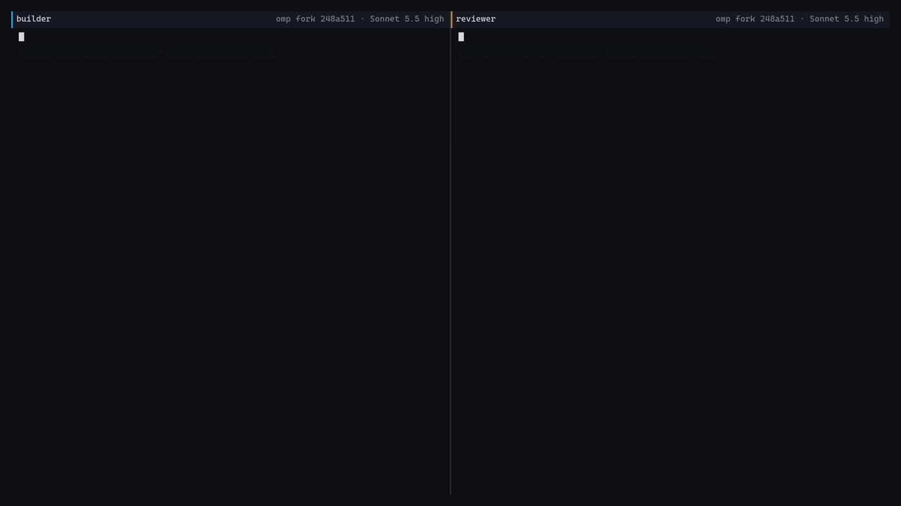
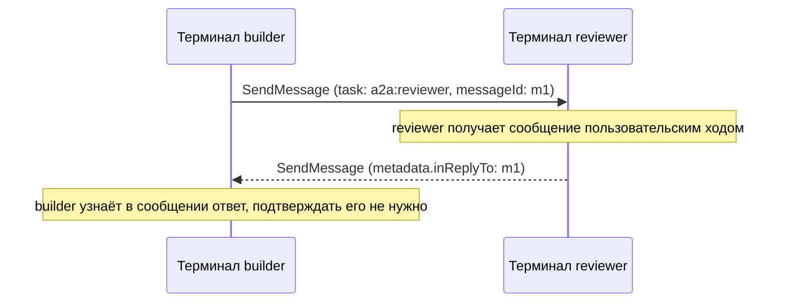
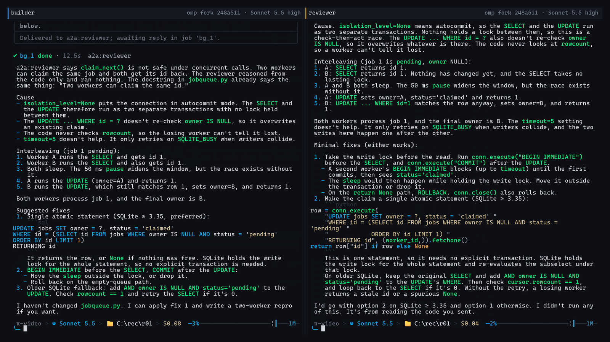
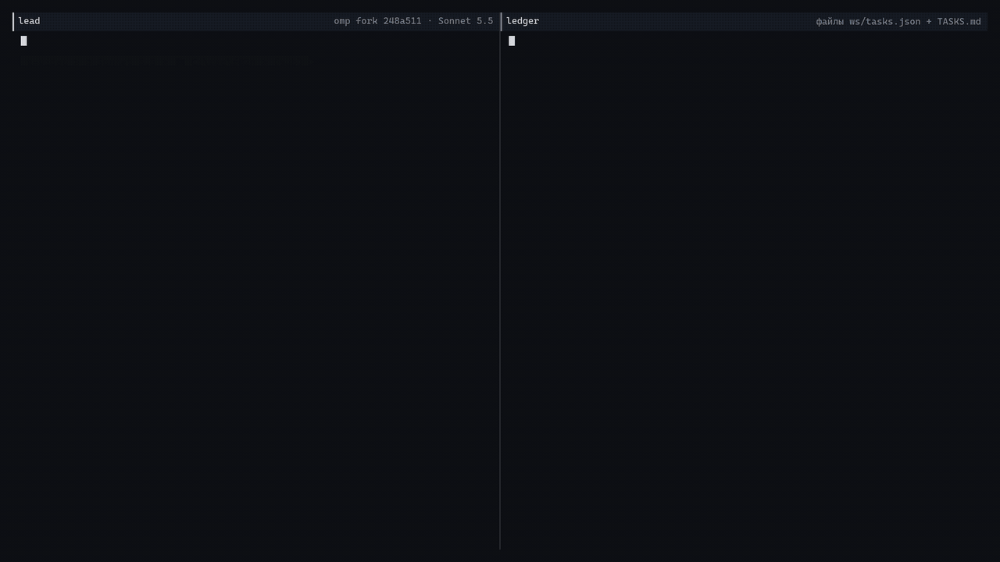
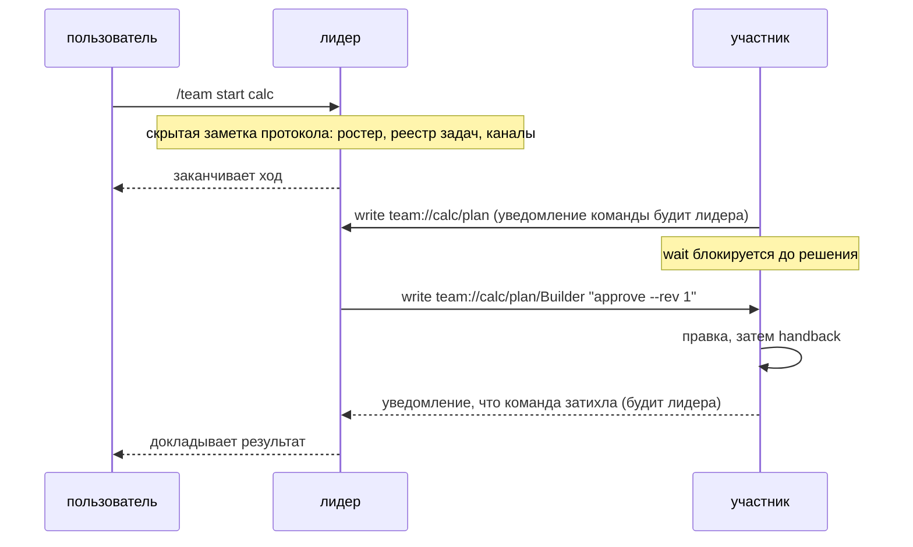

# oh-my-pi-team-agents

Исследовательский форк [oh-my-pi](https://github.com/can1357/oh-my-pi) (`omp`) о том, как кодинг-агенты общаются друг с другом. Агенты здесь сидят в разных терминалах или работают командой внутри одной сессии, а ограничители не дают их переписке разрастись.

[English](README.md) · [Полное руководство по функциям](FORK-RU.md) · [Сборка и сопровождение](README-fork.md)

<p align="center">
  
</p>

## Что исследует форк

Статья [**Внутри Claude Code: как общаются агенты и устроены Agent Teams**](https://llmcrew.org/wiki/claude-code-agent-teams-internals) разбирает бинарник Claude Code 2.1.311 и показывает, как там устроен обмен между агентами: маршруты `SendMessage`, файловые почтовые ящики участников, возврат отчётов, восстановление, лимиты и границы доверия.

Форк - практическая половина того же исследования. Те же задачи решены в открытом агенте и запущены на настоящих терминалах и моделях. Почти всё ниже проверено вживую, исключения отмечены в таблице (см. [Проверено вживую](#проверено-вживую)).

| Задача | Claude Code 2.1.311 (по статье) | Этот форк |
|---|---|---|
| Две независимо запущенные сессии | Маршрут `local-session`: JSONL через сокет домена Unix, файл сессии `~/.claude/sessions/<pid>.json` | Мост A2A v1.0: JSON-RPC 2.0 поверх HTTP на `127.0.0.1`, bearer-токен, файл реестра `a2a-bridges/<pid>.json` на процесс |
| Сообщения между участниками команды | Файловые ящики `~/.claude/teams/<team>/inboxes/<agent>.json` | Внутрипроцессная IRC-шина, `write agent://<хэндл>`, с ingress-гардом; сообщение, которое не удалось доставить в сессию, остаётся в mailbox получателя с квитанцией `queued` |
| Описание команды | Служебное состояние в `config.json`, перезаписывается системой | Декларативный файл `.omp/teams/<имя>.md`, запуск `/team start` |
| Общий список задач | `~/.claude/tasks/<team>/` | Реестр `team://<team>/tasks`: атомарные claim / release / done с проверкой сессии вызывающего; источник истины - `tasks.json`, `TASKS.md` - сгенерированное представление |
| Отчёт вызывающему | `SubagentHandback`: один отчёт, обрамление отступами | Инструмент `handback`: один отчёт за запуск, рамка «вывод модели, а не текст пользователя», экранирование служебных тегов |
| От чьего имени звучит сообщение пира | Обёртка `cross-session-message`; локальный журнал хешей (не подпись) | Запрос из другого терминала приходит пользовательским ходом, никогда не developer-сообщением; служебные теги в теле экранируются |
| Управляющий протокол команды | `shutdown_*`, `plan_approval_*`, `idle_notification` | Утверждение плана (`write team://<team>/plan`, решает лидер), уведомления о простое и «team finished», кооперативная остановка (`team://<team>/stop/<id>`) |

## Механизмы

### 1. Агенты в разных терминалах (мост A2A)

Каждый процесс `omp` поднимает мост [A2A v1.0](https://a2a-protocol.org) на свободном loopback-порту и записывает себя в локальный реестр мостов. Новая сессия находит живые мосты, и её инструмент `task` может обратиться к их главным агентам как к `a2a:<имя>`.



- Терминал адресуется по имени: `omp --a2a-name reviewer`; без имени - автоимя `<slug-каталога>-<pid>`.
- Запрос попадает в главный диалог принимающего терминала. Его агент отвечает сам или поручает работу своим субагентам.
- Ответ связывается с запросом автоматически (`metadata.inReplyTo`). Если главный агент принимающего терминала ответил обычным текстом, а не через `task`, его последний текст хода пересылается отправителю.
- Только loopback, bearer-токен `~/.omp/agent/a2a.token`, методы `SendMessage` / `SendStreamingMessage` (SSE) / `GetTask` / `ListTasks` / `CancelTask`.

Протокол и настройки: [docs/a2a.md](docs/a2a.md).



### 2. Agent Teams (внутри сессии)

Файл команды задаёт участников, хэндлы, необязательные workspace и список задач, а также протокол работы. `/team start <имя>` запускает каждого участника постоянным (kept-alive) субагентом с устойчивым хэндлом; участники пишут друг другу через `agent://<хэндл>` и координируются через протокол `team://<команда>`.

Файлы команд ищутся в двух местах; при совпадении имён побеждает проектный:

- проектная команда `<проект>/.omp/teams/<имя>.md` живёт в репозитории и доступна всем, кто его клонирует;
- пользовательская команда `~/.omp/agent/teams/<имя>.md` доступна в любом проекте (с активным профилем - `~/.omp/profiles/<профиль>/agent/teams/<имя>.md`).

```markdown
---
name: review
description: Two-person code review crew
workspace: ./ws
members:
  - agent: task
    handle: Scout
    role: Find defects in src/
  - agent: task
    handle: Reviewer
    role: Confirm or reject each finding against the code
context: |
  Scout writes each finding to agent://Reviewer and waits for the verdict;
  Reviewer answers agent://Scout with CONFIRMED or REJECTED;
  only Scout reports to the lead. Do not edit src/.
---
Review src/invoice.ts and src/money.ts.
```

<p align="center">
  
</p>

`/team list`, `/team status`, `/team stop [--force] <имя|хэндл|all>`, `/team approve|reject <хэндл> [--team <имя>] [--rev N]`. Включение: `team.enabled: true`; не больше `team.maxTeammates` участников (по умолчанию 4). Подробности: [docs/agent-teams.md](docs/agent-teams.md).

Как идёт запуск команды с утверждением плана:



- Весь протокол живёт в `team://<команда>`. `read` отдаёт обзор (ростер, живой статус, планы) или `/tasks`. Через `write` лидер добавляет задачи в `/tasks`, участники берут и закрывают их через `/tasks/<id>/claim|release|done`, участник отправляет план в `/plan`, лидер решает его в `/plan/<участник>`, а участник отвечает на остановку в `/stop/<id>`. Протокол сверяет каждый вызов с доверенной сессией вызывающего, а на угаданный путь отвечает отказом и списком допустимых.
- Ожиданием управляют уведомления, `wait` ничего не опрашивает. Простаивающего лидера или участника будят план, ждущий решения, решение по плану, «team finished» и уведомление, что затихла вся команда. Остальные уведомления о простое агент увидит в следующем ходе. `wait` ждёт только свои задачи и сервисы или ответ, о котором агент сам просил. Отправленный план - тоже такая просьба, и закрывает её только одобрение или отклонение лидера. Обычное сообщение лидера, пришедшее раньше решения, ожидание не прерывает. Сам лидер ждёт участников, просто заканчивая свой ход.
- Квитанции доставки сообщают, что стало с сообщением `agent://`: `injected`, `woken`, `revived`, `queued` (лежит в mailbox; повтор отклоняется как дубликат) или `failed` (ничего не сохранено; повтор разрешён).
- Модель участника задают `model` и `thinking-level` в файле команды. Если их нет и у агента участника нет своей модели, участник работает на активной модели лидера.

> [!IMPORTANT]
> Если в определении агента участника есть свой промпт, он важнее контекста команды. Read-only определения входят в команду только через team-prompt (у встроенных `scout` и `reviewer` он есть). Писать они могут только для координации, в `agent://` и `team://`, на диск - нет.

### 3. Ограничители межагентного трафика

| Ограничитель | Что ограничивает | Настройка |
|---|---|---|
| IRC ingress-гард | Частота на отправителя, окно дедупликации 30 с, цепочка пересылок до 28, очередь до 50; на отказ приходит квитанция, исключения нет | `irc.ingressGuard`, `irc.rateLimitTokens`, `irc.dedupWindowMs`, `irc.maxHops` |
| Отказ вместо очереди | При исчерпании `task.maxConcurrency` спавн отклоняется с числами и «Do not retry», а не ждёт молча; касается task, A2A, расширений и workflow | `task.concurrencyPolicy: refuse` |
| Токен-бюджет субагента | На 50 % - уведомление `<total_tokens>N tokens left of M</total_tokens>`, на 90 % - указание закругляться | `task.tokenBudget` |
| Capability-токены | Разрушительная операция (удаление грязного worktree, kill агента с несохранённым выводом) сначала отказывает с одноразовым токеном `<8hex>@<id>`; повтор с `force` выполняется | - |
| Права пира | Текст из другого терминала приходит модели пользовательским ходом и не получает прав developer-сообщения | - |

### 4. Детерминированная оркестрация workflow

Инструмент `workflow` исполняет JS-скрипт в песочнице `node:vm` с белым списком глобалов (`agent`, `parallel`, `pipeline`, `phase`, `log`, `clock`, `args`; без `require`, `Date.now`, `Math.random`). Каждый вызов агента пишется в журнал; после kill `resumeFrom` воспроизводит завершённые вызовы из журнала и выполняет только незавершённый хвост. Описание: [docs/tools/workflow.md](docs/tools/workflow.md).

### 5. Прочее

- `pi.spawnSubagent({agent, prompt})` позволяет расширениям запускать субагентов в общем лимите параллельности.
- [chrome-mcp](https://github.com/spgsroot/mcp-chrome-2026-en) находится автоматически на `127.0.0.1:12306` и становится браузером по умолчанию, тогда инструменты `chrome_*` работают в вашем настоящем Chrome. Встроенный `browser` остаётся изолированным запасным вариантом.

## Проверено вживую

Прогон 2026-11-08: Windows 11, бинарник собран из `main`, модель `openai-codex/gpt-6.1-sol:high`, настоящие окна терминалов, изолированный профиль (`OMP_PROFILE=agents`). Демо-репозиторий - сервис `ledger` из трёх файлов с заложенной ошибкой на единицу в `total()`.

| Механизм | Сценарий | Результат |
|---|---|---|
| A2A: запрос и ответ | builder спрашивает `a2a:reviewer`, корректна ли `total()` | Ответ через 22 с, помечен как ответ на запрос (GIF выше) |
| A2A: ни разу не запрошенный получатель | Тот же запрос в свежий терминал | До `b7c805f4fb` - 3 сбоя из 3 (запрос приходил developer-сообщением, модель спрашивала «что сделать?»); после исправления - ответ |
| A2A: ответ обычным текстом | Получатель отвечает в своём чате, не вызывая `task` | Переслан отправителю с `inReplyTo` |
| Agent Teams | `/team start review`, `/team status` | Оба участника заняли строки в `TASKS.md`, Scout и Reviewer переписывались, Scout отправил лиду подтверждённые находки |
| Agent Teams с определениями `scout`/`reviewer` | Та же команда на встроенных определениях | Участники проигнорировали протокол команды. Позже встроенным определениям добавили team-prompt, чтобы они следовали протоколу (см. примечание выше); вживую повторно не проверялось |
| Workflow resume | Двухфазный скрипт убит посреди работы, продолжен с `resumeFrom` | Завершённые вызовы взяты из журнала, выполнен только незавершённый |
| Политика отказа | `maxConcurrency: 1`, три параллельных scout | Один выполнен, два отклонены с «Do not retry» |
| Токен-бюджет | Бюджет 30 000 токенов, субагент читает все файлы | Вставлено `<total_tokens>13896 tokens left of 30000</total_tokens>` |
| `handback` | Субагент завершает работу отчётом из 3 строк | Отчёт доставлен в рамке. В раннем прогоне статус `failed (exit 1)` выдал одноимённый пользовательский инструмент, подменивший встроенный, handback тут ни при чём. Теперь эти имена зарезервированы, а запуск завершается только после принятого отчёта |
| `pi.spawnSubagent` | Инструмент проектного расширения запускает scout | Результат scout вернулся в вызывающую сессию |
| chrome-mcp | Список окон и вкладок | Перечислены окна настоящего Chrome |
| Capability-токен при kill | `proc://<agent>/kill` | Вживую не сработал (транскрипт агента уже был на диске, несохранённой работы не было); покрыт `test/capability-token.test.ts` |

Повторный прогон 2026-11-16 после ревью координации: Windows 11, сборка из исходников, `anthropic/claude-sonnet-5-5:high`, скриптовые RPC-сессии.

| Механизм | Сценарий | Результат |
|---|---|---|
| A2A между двумя процессами | `bun run eval:a2a`: лидер спавнит агента другого терминала через `task`; ответ должен вернуться через reply-job | Пройдено |
| Команда с утверждением плана | `bun run eval:team-coordination`: участник отправляет план, лидер одобряет через `team://`, участник правит, лидер просыпается от итогового уведомления и докладывает | 7 из 7 (последние 3 - со строгой проверкой, что ответ лидера после правки называет `sub`): правка внесена, доля discovery 0 %, 3-4 вызова координации на запуск (10-13 до правок промптов и `wait`) |

На `openai-codex/gpt-6.1-sol:high` те же прогоны не дали результата: у провайдера не было активных аккаунтов (`no_accounts`, `previous_response_owner_unavailable`). Ошибку провайдера скрипты возвращают кодом 2, а не выдают за провал протокола.

Тесты механизмов: `bun run test:coordination` (офлайн-наборы A2A, Teams, IRC и worker-bridge, около 15 с), а также `test/workflow.test.ts`, `test/token-budget.test.ts`, `test/handback.test.ts`, `test/capability-token.test.ts`. Живые прогоны требуют ключей модели: `bun run eval:a2a --model <id>`, `bun run eval:team-coordination --model <id>`.

## Быстрый старт

Сборка из исходников (нужны Bun 1.4.4 или новее и Rust-тулчейн для нативного модуля):

```sh
git clone https://github.com/spgsroot/oh-my-pi-team-agents.git
cd oh-my-pi-team-agents
bun install
bun --cwd=packages/natives run build
bun run --cwd packages/coding-agent build
./packages/coding-agent/dist/omp --version
```

Держите форк отдельно от рабочего `omp`: запускайте его бинарник со своим профилем, например `OMP_PROFILE=agents`. Дальше:

```sh
# терминал 1
omp --a2a-name reviewer
# терминал 2
omp --a2a-name builder
#   > read agent://              (в списке есть a2a:reviewer)
#   > Спроси a2a:reviewer, корректна ли total() в src/invoice.ts.

# команды
omp config set team.enabled true
#   > /team start review
```

Подробности сборки, синхронизация с upstream и обёртка с изолированным профилем: [README-fork.md](README-fork.md).

## Известные ограничения

- Ответ по A2A зависит от того, выполнит ли модель-получатель инструкцию конверта; пересылка текстового ответа работает только для главного агента принимающего терминала, не для его субагентов.
- A2A работает только в пределах машины (loopback). Участия в команде из другого терминала нет.
- Блокировка реестра задач действует в пределах одного процесса omp; другие процессы не должны одновременно работать с тем же workspace команды.
- Живой прогон Teams - один небольшой сценарий (один участник, одна функция); как промпты работают в других сценариях, не измеряли.
- Отложенный A2A-спавн после 30 с ожидания получает статус FAILED; дальше опрашивайте `GetTask` по id задачи.
- Workflow не может прервать асинхронные продолжения после первого `await`.

Полный список: [FORK-RU.md](FORK-RU.md#известные-ограничения).

## Документация

| Тема | Документ |
|---|---|
| Протокол A2A, настройки | [docs/a2a.md](docs/a2a.md) |
| Формат файла команды, команды `/team` | [docs/agent-teams.md](docs/agent-teams.md) |
| Инструмент workflow | [docs/tools/workflow.md](docs/tools/workflow.md) |
| Все функции и настройки форка | [FORK-RU.md](FORK-RU.md) · [README-EN.md](README-EN.md) |
| Upstream omp (установка, провайдеры, инструменты) | [can1357/oh-my-pi](https://github.com/can1357/oh-my-pi) |

## Лицензия

MIT, унаследована от [oh-my-pi](https://github.com/can1357/oh-my-pi), а тот - форк [Pi](https://github.com/badlogic/pi-mono) автора [@mariozechner](https://github.com/mariozechner). Дополнения форка - [spgsroot](https://github.com/spgsroot).
