# oh-my-pi-team-agents

A research fork of [oh-my-pi](https://github.com/can1357/oh-my-pi) (`omp`) about **how coding agents talk to each other**: agents in separate terminals, teammates inside one session, and the guards that keep agent-to-agent traffic bounded.

[Русская версия](README-RU.md) · [Feature reference](README-EN.md) · [Build & maintenance](README-fork.md)

<p align="center">
  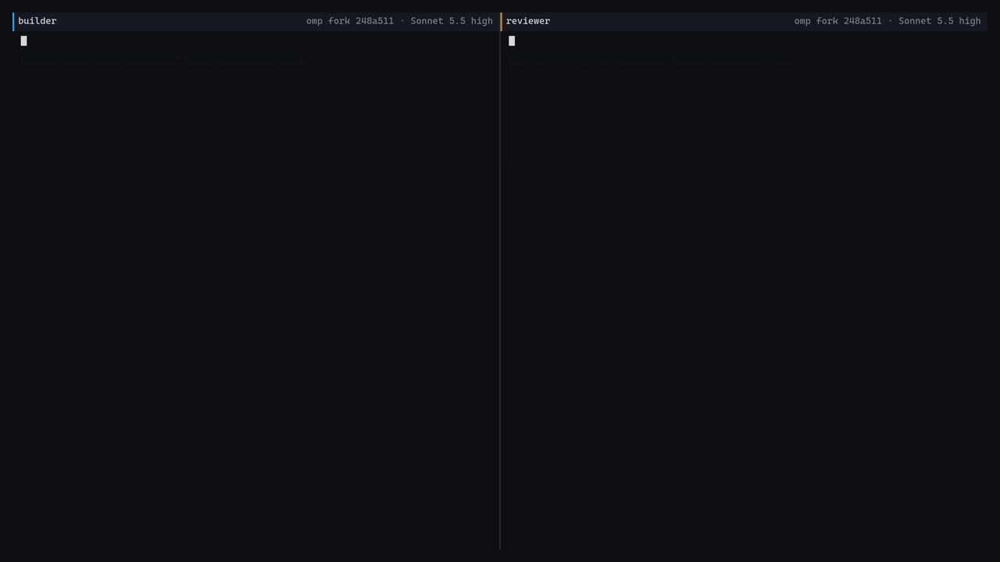
</p>

## What this fork studies

The companion article [**Inside Claude Code: how agents talk and how Agent Teams work**](https://llmcrew.org/wiki/claude-code-agent-teams-internals) (RU, Claude Code 2.1.311, static analysis of the binary) reconstructs Claude Code's agent messaging: `SendMessage` routing, file-backed teammate mailboxes, report hand-back, recovery, limits and trust boundaries.

This fork is the hands-on half of that research: the same problems implemented in an open agent, then exercised with real terminals and models. Almost every mechanism below was checked live; the exceptions are marked in the table (see [Verified live](#verified-live)).

| Problem | Claude Code 2.1.311 (per the article) | This fork |
|---|---|---|
| Two separately started sessions | `local-session` route: JSONL over a Unix domain socket, session file `~/.claude/sessions/<pid>.json` | A2A v1.0 bridge: JSON-RPC 2.0 over HTTP on `127.0.0.1`, bearer token, per-process registry file `a2a-bridges/<pid>.json` |
| Teammate messaging | File mailboxes `~/.claude/teams/<team>/inboxes/<agent>.json` | In-process IRC bus, `write agent://<handle>`, with an ingress guard; a hand-off that cannot reach the session is kept in the recipient's mailbox and reported `queued` |
| Team definition | Runtime state in `config.json`, rewritten by the harness | Declarative file `.omp/teams/<name>.md`, started with `/team start` |
| Shared task list | `~/.claude/tasks/<team>/` | `team://<team>/tasks` ledger: atomic claim / release / done checked against the caller's session; `tasks.json` is authoritative, `TASKS.md` a generated view |
| Report back to the caller | `SubagentHandback`: one report, indentation framing | `handback` tool: one report per run, "model output, not user text" frame, harness-tag escaping |
| Who a peer message speaks as | Envelope `cross-session-message`; local hash ledger (not a signature) | A peer terminal's request is a **user** turn, never a developer message; harness tags in the body are escaped |
| Team control protocol | `shutdown_*`, `plan_approval_*`, `idle_notification` | Plan approval gate (`write team://<team>/plan`, decided by the lead), idle and "team finished" notices, cooperative stop (`team://<team>/stop/<id>`) |

## Compared with stock Pi

This comparison is about the **default Pi coding-agent CLI**, without third-party packages or custom orchestration. The original `badlogic/pi-mono` URL now redirects to `earendil-works/pi`; the baseline is its [source at `9cd49d2c00`](https://github.com/earendil-works/pi/blob/9cd49d2c00ac446f774b878d25923bdb3739dadd/README.md), checked on 2026-11-16. It is not a claim about every application or library in that monorepo.

Pi deliberately leaves subagents and plan mode to extensions and packages. It already has saved sessions, branching, compaction, steering, an SDK and RPC: those are not inventions of this fork. The lineage is **Pi → oh-my-pi → this fork**. The `task` subagent runtime and IRC messaging infrastructure come from oh-my-pi; this fork builds the A2A bridge, Teams protocol and additional coordination controls on that base.

| Mechanism | Stock Pi CLI | This fork and the practical advantage |
|---|---|---|
| Delegation and reusable teams | Subagents are an extension/package choice, not a default CLI feature. | Uses omp's subagent runtime; adds `.omp/teams/<name>.md` with roles, member models and optional plan approval. A recurring team can be started with `/team start` instead of assembling an orchestrator for each project. |
| Communication between terminals | [RPC](https://github.com/earendil-works/pi/blob/9cd49d2c00ac446f774b878d25923bdb3739dadd/packages/coding-agent/docs/rpc.md) lets an external controller drive a child process through stdin/stdout JSONL. This is a host-control interface, not peer discovery. | [A2A](docs/a2a.md) discovers local terminals, addresses them by name and correlates replies over authenticated loopback HTTP. Already-running agents can ask one another for work without a separate routing application. |
| Shared ownership of work | The default CLI does not supply the Teams task-claim protocol; a multi-agent extension or controller must provide its own coordination. | [The task ledger](docs/agent-teams.md#task-protocol) checks claim/release/done against the caller and rejects a competing claim with the owner's name. Ownership is runtime state rather than a promise in a prompt; it does not lock source files. |
| Approval before a teammate edits | Pi explicitly leaves plan mode out of the default CLI. A request to “plan first” alone is not an enforced tool gate. | [Plan approval](docs/agent-teams.md#plan-submission-and-approval) blocks disallowed tools until the lead approves the member's current plan revision. Stale approvals are refused; approval does not expand the member's existing permissions. |
| Waiting and stopping | Pi exposes run lifecycle events, abort and orderly process shutdown through RPC. A controller supplies any team-level policy. | [Team notices](docs/agent-teams.md#idle-notices-and-messaging) wake idle agents when action is needed; [cooperative stop](docs/agent-teams.md#cooperative-stop) requests an acknowledgement from a member. The lead can coordinate completion without treating a whole terminal process as the unit of work. |
| Traffic and spawn pressure | With no default subagent/team layer, Pi leaves these coordination policies to the chosen extension or host. | [Ingress guards](docs/settings.md#peer-messaging-guard-ircbus) bound message rate, duplicates and relay chains. Optional spawn refusal makes saturation explicit, and token-budget notices steer members toward finishing. These reduce specific coordination failure modes; they are not a hard spending cap. |
| Resuming orchestration | Pi's [session resume and branching](https://github.com/earendil-works/pi/blob/9cd49d2c00ac446f774b878d25923bdb3739dadd/packages/coding-agent/docs/usage.md#continue-or-start-over) restore conversations. A multi-agent workflow needs its own execution bookkeeping. | The [workflow journal](docs/tools/workflow.md) replays completed agent calls and runs the unfinished tail. Conversation recovery and workflow recovery are separate mechanisms; this does not guarantee exactly-once external side effects. |

### When this fork is the better fit

Choose it when the job needs **several agents with explicit ownership, approval and delivery rules**, especially agents already running in separate local terminals. The advantage is an integrated coordination protocol: less routing and lifecycle code to build yourself, and decisions such as “who owns this task?” or “may this member edit yet?” checked by the runtime rather than left only in model instructions.

Choose stock Pi when you want a minimal single-agent harness or prefer to select and maintain your own extensions. Its SDK, RPC and packages can support custom multi-agent systems; the comparison above is about what is integrated here, not what Pi could be extended to do.

Teams must be enabled (`team.enabled: true`); spawn refusal and token budgets are opt-in. A2A is machine-local, the ledger lock covers one omp process, and plan gates are not an OS sandbox. The [live runs and recordings](#verified-live) demonstrate these mechanisms, **not a head-to-head benchmark against Pi**: no claim of better model accuracy, lower total token cost or faster completion is established.

## Mechanisms

### 1. Cross-terminal agents (A2A bridge)

Every `omp` process serves an [A2A v1.0](https://a2a-protocol.org) bridge on a free loopback port and registers itself in the machine-local bridge registry. A new session discovers the live bridges and exposes their main agents as `a2a:<name>` targets of the ordinary `task` tool.

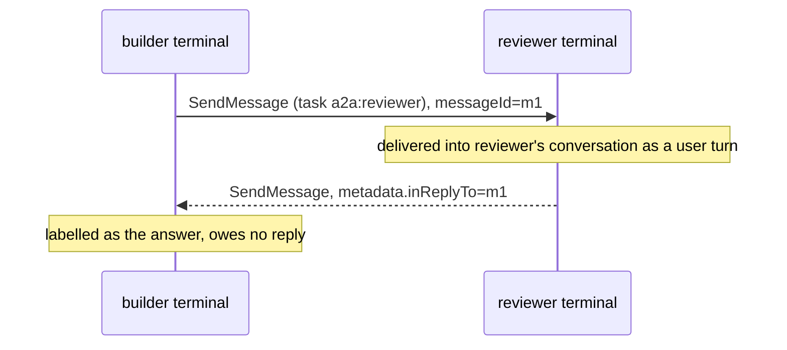

- Address a terminal by name: start it with `omp --a2a-name reviewer`, or let it auto-name as `<cwd-slug>-<pid>`.
- The request lands in the receiving terminal's **main conversation**; that agent answers itself or delegates to its own subagents.
- The reply is correlated automatically (`metadata.inReplyTo`). If the receiving main agent answers in plain text instead of calling `task`, its last text of the turn is relayed to the requester.
- Loopback only, bearer token `~/.omp/agent/a2a.token`, `SendMessage` / `SendStreamingMessage` (SSE) / `GetTask` / `ListTasks` / `CancelTask`.

Wire contract and settings: [docs/a2a.md](docs/a2a.md).

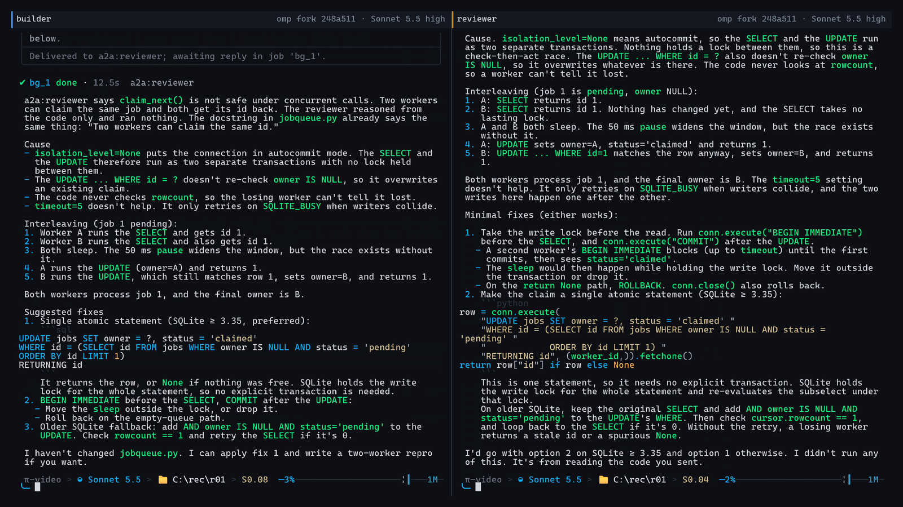

### 2. Agent Teams (in-session)

A team file declares members, handles, an optional workspace and task list, and the protocol they follow. `/team start <name>` spawns every member as a kept-alive subagent with a stable handle; members message each other with `agent://<handle>` and coordinate through the `team://<team>` protocol.

Team files are discovered from two scopes; on a name collision the project file wins:

- **Project team:** `<project>/.omp/teams/<name>.md` — lives with the repository and is shared by everyone who clones it;
- **User team:** `~/.omp/agent/teams/<name>.md` — available in every project (with an active profile: `~/.omp/profiles/<profile>/agent/teams/<name>.md`).

Enable once with `team.enabled: true`, create the file, then run `/team start <name> [assignment]`. `/team list` shows every discovered team.

`.omp/teams/review.md`:

```markdown
---
name: review
description: Two-person code review crew
workspace: ./ws
members:
  - agent: task
    handle: Scout
    role: Find defects in src/
  - agent: task
    handle: Reviewer
    role: Confirm or reject each finding against the code
context: |
  Scout writes each finding to agent://Reviewer and waits for the verdict;
  Reviewer answers agent://Scout with CONFIRMED or REJECTED;
  only Scout reports to the lead. Do not edit src/.
---
Review src/invoice.ts and src/money.ts.
```

<p align="center">
  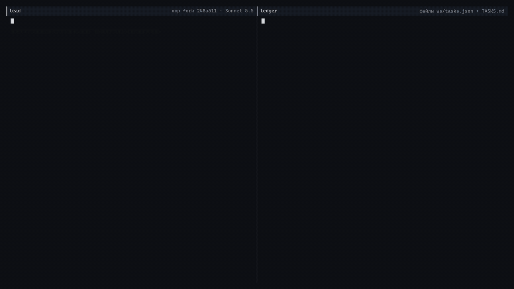
</p>

`/team list`, `/team status`, `/team stop [--force] <name|handle|all>`, `/team approve|reject <handle> [--team <name>] [--rev N]`. Enable with `team.enabled: true`; at most `team.maxTeammates` (default 4) members. Details: [docs/agent-teams.md](docs/agent-teams.md).

How a plan-gated team run goes:

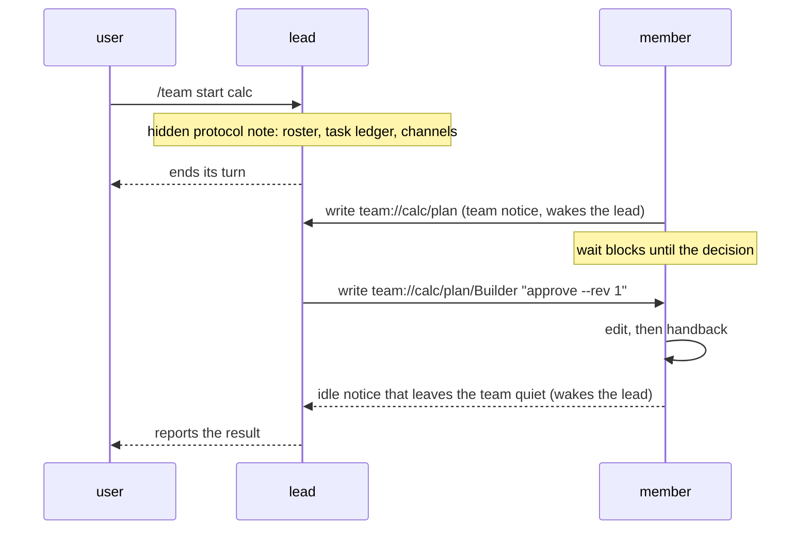

- **`team://<team>`** is the whole protocol: `read` the overview (roster, live status, plans) or `/tasks`; `write` `/tasks` (lead adds), `/tasks/<id>/claim|release|done`, `/plan` (member submits), `/plan/<member>` (lead decides), `/stop/<id>` (member answers a stop). Every call is checked against the caller's trusted session; a guessed path is refused with the list of valid ones.
- **Notices wake, `wait` does not poll.** Plan submissions, plan decisions, "team finished" and the idle notice that leaves the whole team quiet wake an idle lead or member; other idle notices fold into the next turn. `wait` blocks only on the caller's own jobs and services or on a reply it asked for. A plan submission counts as asked: only the lead's approval or rejection answers it, so an ordinary message from the lead in between does not end the member's wait for good. A lead waits for its members by ending its turn.
- **Delivery receipts** name what happened to an `agent://` message: `injected`, `woken`, `revived`, `queued` (kept in the mailbox; a retry is refused as a duplicate) or `failed` (nothing kept; a retry is allowed).
- **Per-member model:** `model` and `thinking-level` in the team file; without them a member whose agent has no model of its own runs on the lead's active model.

> [!IMPORTANT]
> A member's own definition prompt outranks the team context. Read-only definitions join only through a team prompt (the bundled `scout` and `reviewer` ship one) and get coordination-only write to `agent://` and `team://`, never disk.

### 3. Guards for agent-to-agent traffic

| Guard | What it bounds | Setting |
|---|---|---|
| IRC ingress guard | Per-sender rate, 30 s dedup window, relay hops ≤ 28, queue ≤ 50; refusals are receipts, not errors | `irc.ingressGuard`, `irc.rateLimitTokens`, `irc.dedupWindowMs`, `irc.maxHops` |
| Refuse instead of queue | When `task.maxConcurrency` is exhausted, a spawn fails with numbers and "Do not retry" instead of waiting silently; covers task, A2A, extensions and workflow spawns | `task.concurrencyPolicy: refuse` |
| Subagent token budget | At 50 % a `<total_tokens>N tokens left of M</total_tokens>` notice, at 90 % a wrap-up steer | `task.tokenBudget` |
| Capability tokens | A destructive operation (dirty worktree removal, killing an agent with unsaved output) first refuses with a one-shot `<8hex>@<id>` token; the retry with `force` executes | — |
| Peer authority | Text from another terminal reaches the model as a user turn, so it never carries developer authority | — |

### 4. Deterministic workflow orchestration

The `workflow` tool runs a JS script in a `node:vm` sandbox with an allowlist of globals (`agent`, `parallel`, `pipeline`, `phase`, `log`, `clock`, `args`; no `require`, `Date.now`, `Math.random`). Every agent call is journaled; after a kill, `resumeFrom` replays completed calls from the journal and runs only the unfinished tail. Reference: [docs/tools/workflow.md](docs/tools/workflow.md).

### 5. Other additions

- `pi.spawnSubagent({agent, prompt})` lets extensions start subagents under the shared concurrency limit.
- [chrome-mcp](https://github.com/spgsroot/mcp-chrome-2026-en) is auto-discovered on `127.0.0.1:12306` as the default browser: `chrome_*` tools in your real Chrome. The built-in `browser` tool stays as the isolated fallback.

## Verified live

Run on 2026-11-08: Windows 11, binary built from `main`, model `openai-codex/gpt-6.1-sol:high`, real terminal windows, isolated profile (`OMP_PROFILE=agents`). Demo repository: a three-file `ledger` service with a seeded off-by-one in `total()`.

| Mechanism | Scenario | Result |
|---|---|---|
| A2A request and answer | builder asks `a2a:reviewer` whether `total()` is correct | Answer back in 22 s, labelled as the reply to the request (GIF above) |
| A2A, never-prompted receiver | Same request into a fresh terminal | Failed 3 of 3 before `b7c805f4fb` (request arrived as a developer message, model asked "what would you like me to do?"); answered after the fix |
| A2A plain-text answer | Receiver answers in its own chat instead of calling `task` | Relayed to the requester with `inReplyTo` |
| Agent Teams | `/team start review`, `/team status` | Both members claimed rows in `TASKS.md`, Scout and Reviewer messaged each other, Scout reported confirmed findings |
| Agent Teams with `scout`/`reviewer` definitions | Same team, bundled definitions | Members ignored the team protocol. The bundled team prompts added afterwards (see the note above) target this; not re-run live |
| Workflow resume | Two-phase script killed mid-run, resumed with `resumeFrom` | Completed calls replayed from the journal, only the unfinished call ran |
| Refuse policy | `maxConcurrency: 1`, three parallel scouts | One ran, two refused with "Do not retry" |
| Token budget | 30 000-token budget, subagent reads every file | `<total_tokens>13896 tokens left of 30000</total_tokens>` injected |
| `handback` | Subagent ends with a 3-line report | Report delivered in the framed envelope. An earlier run marked `failed (exit 1)` was caused by a same-named custom tool replacing the built-in, not by a successful handback; reserved names and accepted-result-only termination prevent that mismatch |
| `pi.spawnSubagent` | Project extension tool spawns a scout | Scout result returned to the calling session |
| chrome-mcp | List windows and tabs | Real Chrome windows listed |
| Capability token on kill | `proc://<agent>/kill` | Not triggered live (the agent's transcript was already on disk, so no unsaved work); covered by `test/capability-token.test.ts` |

Re-run on 2026-11-16 after the coordination review: Windows 11, source build, `anthropic/claude-sonnet-5-5:high`, scripted RPC sessions.

| Mechanism | Scenario | Result |
|---|---|---|
| A2A between two processes | `bun run eval:a2a`: the lead spawns the peer terminal's agent through `task`; the answer must come back through the reply job | Pass |
| Plan-gated team | `bun run eval:team-coordination`: member submits a plan, lead approves through `team://`, member edits, lead wakes on the final notice and reports | 7 of 7 pass (the last 3 with the stricter check that the lead's post-edit reply names `sub`): change landed, discovery share 0 %, 3-4 coordination calls per run (10-13 before the prompt and `wait` fixes) |

The same evals on `openai-codex/gpt-6.1-sol:high` were inconclusive: the provider had no active accounts (`no_accounts`, `previous_response_owner_unavailable`); the scripts exit 2 for a provider failure instead of reporting it as a protocol failure.

Mechanism suites: `bun run test:coordination` (offline A2A, Teams, IRC and worker-bridge suites, about 15 s), plus `test/workflow.test.ts`, `test/token-budget.test.ts`, `test/handback.test.ts`, `test/capability-token.test.ts`. Live evals need model credentials: `bun run eval:a2a --model <id>`, `bun run eval:team-coordination --model <id>`.

### Screen recordings

Recorded on 2026-11-16 on the build at `248a51175d` with `anthropic/claude-sonnet-5-5`, in real terminals. The A2A clip at the top and the team clip in [Agent Teams](#2-agent-teams-in-session) come from the same series. The GIFs are previews; the 4K MP4 originals are not stored in this repository. Thinking level is `high` except for the team clip with the ledger and the metric clip (`low`).

**Claim conflict.** Dev claims task 1; the lead's own claim is refused with `Task 1 is owned by Dev`, and `tasks.json` keeps `"owner": "Dev"`.

<p align="center">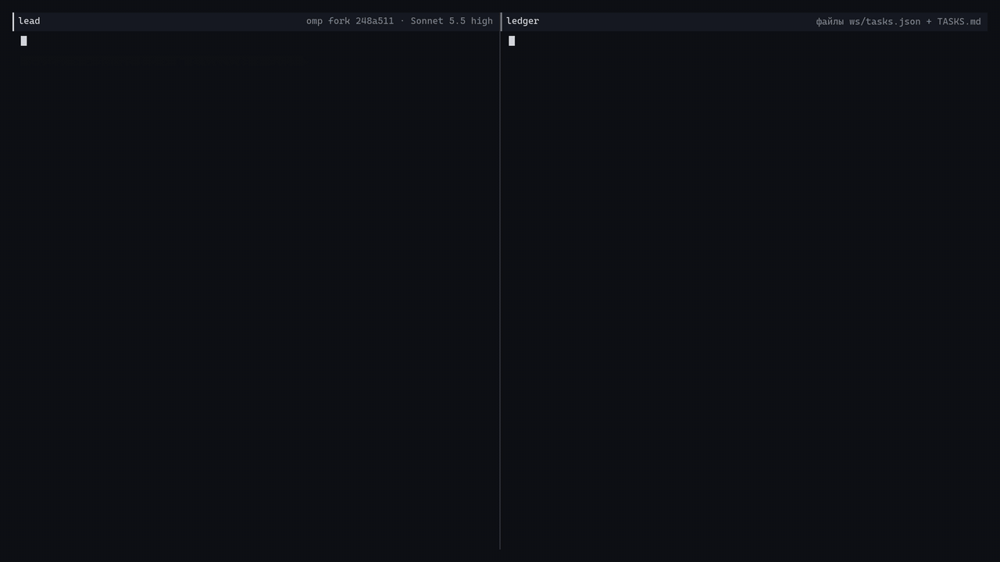</p>

**Ingress guard.** The lead sends three `write agent://Dev` calls in one turn. The first is delivered. The second is refused (`rate limited: "Main" may send 30 tokens per 500 ms`), and a repeat of the first is refused as a duplicate within 30000 ms.

<p align="center">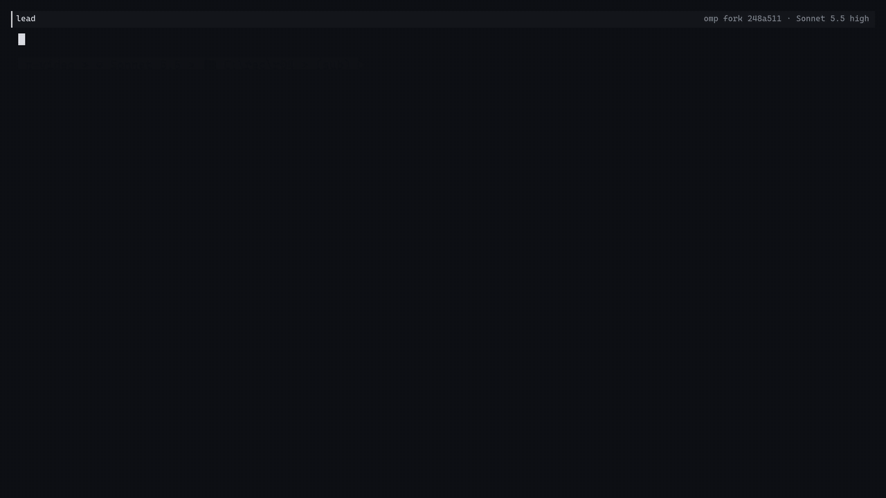</p>

**Plan gate.** Dev submits a plan through `write team://gate/plan`, the lead approves it through `write team://gate/plan/Dev`. The file watcher shows `jobqueue.py` untouched until the approval and changed about two seconds later. The lead then re-runs the test and closes the task. The idle notice in the clip quotes Dev's first line (`Submit plan first.`), not its final report.

<p align="center">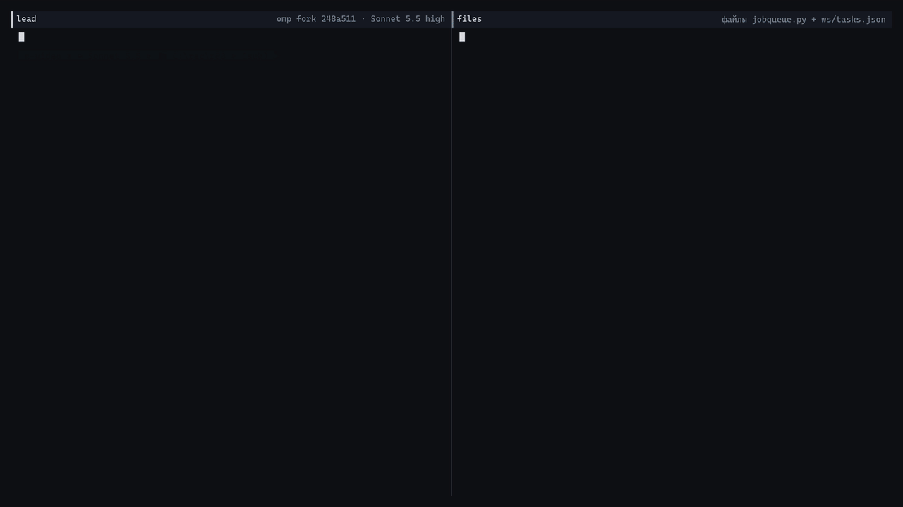</p>

**Stale plan revision.** The user rejects rev 1, Dev resubmits as rev 2, and `/team approve Dev --rev 1` fails with `Stale plan revision 1; current is 2`. Approving rev 2 succeeds.

<p align="center">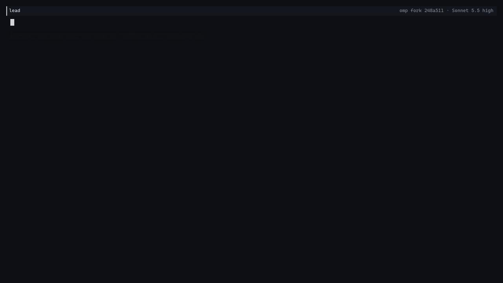</p>

**Cooperative stop.** `/team stop jobqueue` asks Dev to stop, Dev acknowledges, and the lead gets `Team jobqueue finished: no members left.`

<p align="center">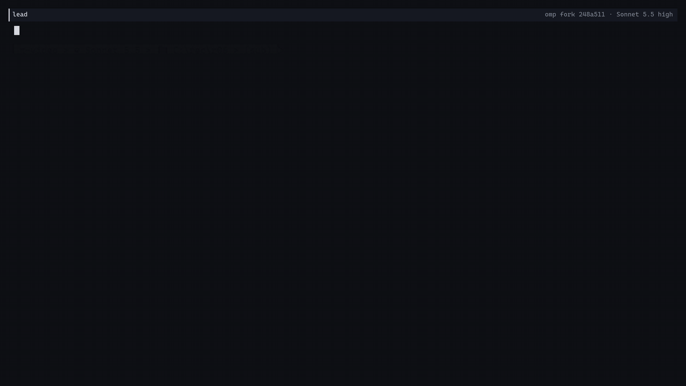</p>

**Coordination metric.** `bun run metric:team-coordination` over the transcripts of the team clip: 31 coordination calls, 23 work calls, no discovery calls, discovery share 0.0 % (limit 10 %).

<p align="center">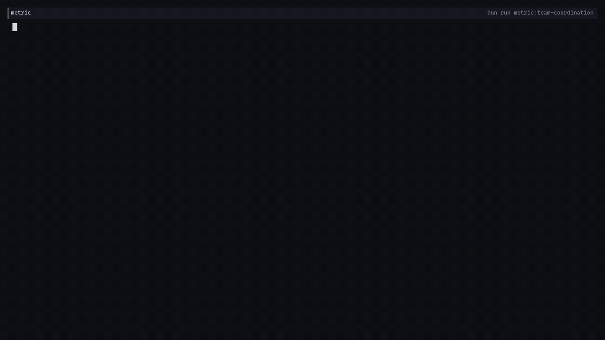</p>

## Quick start

Build from source (Bun ≥ 1.4.4 and a Rust toolchain for the native addon):

```sh
git clone https://github.com/spgsroot/oh-my-pi-team-agents.git
cd oh-my-pi-team-agents
bun install
bun --cwd=packages/natives run build
bun run --cwd packages/coding-agent build
./packages/coding-agent/dist/omp --version
```

Keep it apart from a production `omp`: run the fork binary with its own profile, e.g. `OMP_PROFILE=agents`. Then:

```sh
# terminal 1
omp --a2a-name reviewer
# terminal 2
omp --a2a-name builder
#   > read agent://              (lists a2a:reviewer)
#   > Ask a2a:reviewer whether total() in src/invoice.ts is correct.

# teams
omp config set team.enabled true
#   > /team start review
```

Build details, upstream sync and the isolated-profile wrapper: [README-fork.md](README-fork.md).

## Known limitations

- An A2A answer depends on the receiving model following the envelope; the plain-text relay covers only the receiving terminal's main agent, not its subagents.
- A2A is machine-local (loopback). There is no cross-terminal team membership.
- The task ledger lock covers one omp process; other processes must not share a team workspace concurrently.
- The Teams live eval is a single small scenario (one member, one function); prompt changes beyond it are not measured.
- An A2A pending spawn past the 30 s grace is reported as failed; poll `GetTask` by task id.
- Workflow cannot interrupt async continuations after the first `await`.

Full list: [FORK-RU.md](FORK-RU.md#известные-ограничения) (RU).

## Documentation

| Topic | Document |
|---|---|
| A2A wire contract, settings | [docs/a2a.md](docs/a2a.md) |
| Agent Teams file format, commands | [docs/agent-teams.md](docs/agent-teams.md) |
| Workflow tool | [docs/tools/workflow.md](docs/tools/workflow.md) |
| All fork features and settings | [README-EN.md](README-EN.md) · [FORK-RU.md](FORK-RU.md) |
| Upstream omp (install, providers, tools) | [can1357/oh-my-pi](https://github.com/can1357/oh-my-pi) |

## License

MIT, inherited from [oh-my-pi](https://github.com/can1357/oh-my-pi), which is a fork of [Pi](https://github.com/badlogic/pi-mono) by [@mariozechner](https://github.com/mariozechner). Fork additions by [spgsroot](https://github.com/spgsroot).
